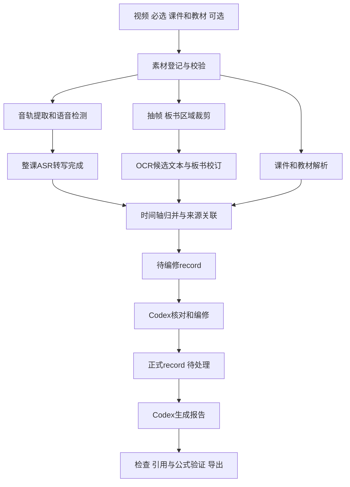

# Lecture Agent 项目实施计划

计划日期：2026年10月31日。

当前已固定视频通路v1：课程初始化、固定阶段运行、后台监督、语义门禁、产物指纹复用均已实现并验证，入口见[当前工作流](WORKFLOW.md)。本文件保留完整目标规划；通用队列、辅助资料解析与更多平台适配仍待实施。

用户确认后续工作目录为 `/Users/wens/Work/CC/lecture-to-notes`；输出统一在项目内 `outputs/<课程名>/第<两位周次>周（<当周课次>）-<核心内容>/`。

已确认的运行方式：**本地命令行处理素材与调度任务，Codex 负责板书校订、record 编修和总结。** 第一版面向当前 macOS Apple Silicon 环境。视频为必选输入，课件和教材为可选输入；缺少它们时仍能完成视频分析，并说明资料范围。

## 1 目标与交付物

给出一节课的视频，以及可选课件、教材，最终获得：

1. 原始素材及来源清单。
2. 具有真实视频时间戳的课堂图片和板书裁剪图。
3. 逐帧板书OCR原文、校订后的板书文字与LaTeX公式。
4. 提取的音轨、语音活动区间、分段语音转写、字幕和转写质量标记。
5. 课件与教材的页级文字、图片和来源索引。
6. 按时间归并、可回查来源的课堂内容记录。
7. 编修完成的正式 record。
8. 课程讲解报告，含知识点、推导、例题、引用、存疑项与复习建议。
9. 每个阶段的状态、日志、配置、模型信息和检查结果。

第一版交付 Markdown 和可离线阅读的 HTML。PDF、DOCX、课程网站和跨课程知识库放在后续扩展，不影响核心流程。

## 2 固定的工作流程



本地抽帧、ASR、资料解析可以独立运行；**整课转写未完成时不启动最终 record 编修，也不生成最终报告**。板书识别可以先准备候选材料。最终报告只能消费已编修的 record 及其证据。

自动清理稿不是正式 record。后台任务完成也不等于内容编修完成。状态必须表达这种区别。

## 3 模块与实现方法

| 模块 | 主要职责 | 第一版实现方法 | 主要输出 |
|---|---|---|---|
| download 视频获取 | 将发现方式与传输方式分开，取得原视频 | tools/video_download：站点profile与浏览器发现工作流；direct_http、local_file适配器；其他协议明确交接；验证后登记来源 | 00_sources/video、下载回执、来源记录 |
| ingest 素材登记 | 接收视频、课件、教材，固定来源和角色 | Python文件接口；计算SHA-256；登记路径、格式、大小、来源；校验视频可读性；默认复制素材，可显式选择引用模式 | lesson.yaml、sources.jsonl |
| media 媒体处理 | 获取流信息、提取音轨、统一时间基准 | FFprobe读取时长及流时间信息；FFmpeg提取单声道16kHz PCM WAV；记录音轨相对视频的时间偏移和任何预处理映射 | media.json、audio.wav、time_map.json |
| frames 抽帧 | 固定间隔采样、板书ROI裁剪、筛选有变化的画面 | 默认约10秒采样；保存被选帧真实PTS；保留全画面；ROI可配置；用感知哈希或图像差异减少重复候选；Codex可申请某区间加密抽帧 | full/*.jpg、board/*.jpg、frames.jsonl、keyframes.jsonl |
| board 板书转文本 | 手写文字、公式及图示含义的提取和校订 | Apple Vision生成OCR候选和坐标；Codex结合原图校正中文、上下标、公式和图示；按板书变化合并；遮挡或读不清时保留标记并申请补帧 | raw_ocr.jsonl、reviewed_board.jsonl、board.md |
| asr 语音识别 | 本地整课转写、检查点、字幕和候选清理 | 复用本机已验证的MLX Whisper；Silero VAD在识别前定位语音；按带短重叠的时间窗口转写；映射回原视频时间；重叠文本去重；保留原始评分和模型信息 | chunks/*.json、raw.jsonl、candidate.jsonl、transcript.txt、subtitles.srt |
| documents 资料解析 | 把课件与教材变成可定位的辅助材料 | 首版支持PDF及PPTX；PDF逐页提取文字与页面图片，扫描页进入OCR；PPTX提取幻灯片文字、备注和图片，渲染通过可配置的转换适配器；教材按页与章节索引 | pages.jsonl、pages/*.png、sections.jsonl |
| timeline 时间轴整理 | 汇总语音、板书变化、课件和教材关联 | 以原视频毫秒时间为轴；按重叠区间及板书有效时间段归并；语义匹配只生成资料关联候选，由Codex核对；保留多对多来源关系 | events.jsonl、segments.jsonl、source_links.jsonl、timeline.md |
| record 记录编修 | 将候选材料编修成正式课堂记录 | 本地生成任务包；Codex按章节分批处理，结合语音和图像核对；保留原意、公式、时间戳、来源和未确认项；区分教师讲解、资料补充和整理者推导 | draft/record.md、ready/record.md、record.json、edit_log.jsonl |
| report 报告生成 | 根据正式record解释课程内容 | Codex生成结构化报告与引用；模板定义课程目标、知识框架、概念、推导、例题、易错点、练习、存疑项；确定性渲染Markdown和LaTeX到离线HTML；数学图按明确方程重绘并标为重绘 | report.md、report.html、assets/、references.jsonl |
| quality 质量检查 | 判断阶段是否完整、内容能否进入下一阶段 | Python结构校验、时间范围和引用检查；检查缺失片段、异常重复、识别语言异常、公式解析和HTML资源；Codex做语义核对；存疑项保留，关键缺失阻止错误定稿 | checks.json、issues.jsonl、review_notes.md |
| orchestrator 任务调度 | 后台运行、状态、进度、断点续跑和Codex交接 | Python CLI与本地worker；SQLite作为状态唯一来源；阶段依赖图；检查点、锁与任务租约；状态JSON只作导出；事件日志记录状态变化 | jobs.sqlite、run.json、events.jsonl、logs/、agent_tasks/ |

board、record、report 是同一个 Codex 在不同任务阶段执行，不要求创建多个子agent。模块化体现为输入输出协议、执行器和独立可运行的阶段，而不是每个模块都单独调用一个大模型。

## 4 项目代码结构

以下是完整agent的目标结构；当前实际已部署的文件与可运行命令以项目README为准，不将尚未创建的模块或锁文件视为已实现。

项目名：`lecture-to-notes`；CLI名称保留 `lecture-agent`。

项目目录：`/Users/wens/Work/CC/lecture-to-notes/`。

```text
lecture-to-notes/
├── AGENTS.md                  # Codex项目规范、入口、阶段边界和质量要求
├── README.md                  # 安装、命令和使用教程
├── pyproject.toml             # Python项目与CLI入口
├── uv.lock                    # 锁定经验证的Python依赖
├── .gitignore                 # 排除视频、模型、课程数据、缓存和凭据
├── configs/
│   ├── default.yaml           # 采样、ASR、VAD、语言、输出和质量设置
│   └── profiles/
│       └── macos-apple-silicon.yaml
├── docs/
│   ├── PLAN.md                # 本计划
│   ├── architecture.md        # 模块接口与依赖
│   └── data-contracts.md      # 字段、单位、来源和版本约定
├── schemas/
│   ├── source.schema.json
│   ├── frame.schema.json
│   ├── transcript.schema.json
│   ├── board.schema.json
│   ├── timeline.schema.json
│   ├── record.schema.json
│   └── task.schema.json
├── src/lecture_agent/
│   ├── cli.py
│   ├── core/                  # 配置、数据类型、artifact引用、时间与来源
│   ├── ingest/
│   ├── media/
│   ├── frames/
│   ├── board/
│   ├── asr/
│   ├── documents/
│   ├── timeline/
│   ├── record/
│   ├── report/
│   ├── quality/
│   ├── orchestrator/
│   └── adapters/              # MLX、Apple Vision、FFmpeg、Codex任务包
├── agent/
│   ├── workflows/             # 阶段说明与任务操作规范
│   ├── prompts/               # 板书、语音编修、record、报告的任务模板
│   └── templates/             # record、报告及交接任务模板
├── scripts/                   # 环境诊断与开发辅助
└── tests/
    ├── fixtures/              # 小型、可公开或人工构造的测试材料
    ├── test_timestamps.py
    ├── test_resume.py
    ├── test_provenance.py
    └── test_record_gates.py
```

第一版采用一个Python项目与一个CLI，不拆微服务。Swift仅作为Apple Vision适配器的内部实现。FFmpeg通过参数数组调用，避免Shell拼接文件名。

Codex读取项目规范后，从任务包获得本阶段需要的片段和图片，不一次把几百张图与整本教材塞入上下文。任务包包括输入引用、需要处理的区间、目标输出格式、检查命令和完成条件。

`AGENTS.md`用于Codex项目规范的依据见[OpenAI官方说明](https://developers.openai.com/cookbook/examples/codex/iterating-development-workflows-with-codex)。其他任务文件、队列格式和目录名称是本项目设计，不是Codex内置要求。

## 5 一节课的数据目录

用户已确认课程素材与产物放在项目内的 outputs；整个 outputs 不提交Git。旧版计划的外置 Documents/LectureAgent 建议由本节替代。

命名固定为 `outputs/<课程名>/第<两位周次>周（<当周第1或2次课>）-<核心内容>/`。核心内容初始可用“待整理”，编修后更新。

```text
lecture-to-notes/outputs/
├── index.html
└── 动力系统/
    └── 第02周（1）-一维系统分岔/
        ├── lesson.yaml
        ├── status.json
        ├── index.html
        ├── 00_sources/       # video、slides、textbook、sources.jsonl
        ├── 01_audio/         # audio.wav、media.json
        ├── 02_frames/        # full、board、frames.jsonl、图片索引
        ├── 03_board/         # raw、reviewed
        ├── 04_transcripts/   # 分段JSON、原始转写、清理稿、字幕、审计
        ├── 05_documents/     # 课件教材解析结果
        ├── 06_timeline/      # events.jsonl、segments.jsonl、资料引用
        ├── 07_record/        # draft待编修、ready正式记录
        ├── 08_report/        # Markdown、HTML与离线assets
        ├── 09_quality/       # 质量和完整性检查
        └── _runs/            # 各次运行日志、配置和历史产物索引
```

目录根层展示当前成果；完整调度器重跑前须将受影响成果归档或建立版本引用，不能覆盖已编修record而不保留历史。`_runs/`保存运行记录。当前部署保留已有课程的JSON/CSV文件名，后续字段变更必须显式迁移。

通用任务状态库规划为 `outputs/.state/jobs.sqlite`。当前仅部署已导入课程的status.json，完整SQLite调度尚待实现。

模型和Python环境继续共享，第一版复用 `~/.local/share/codex-course-tools/`，可通过配置及环境变量更换。视频只在课目录归档一次，模型不按课程重复复制。导出应解析完整相对引用，不能依赖旧下载目录。

## 6 文件格式与最小数据协议

| 内容 | 主格式 | 说明 |
|---|---|---|
| 用户配置 | YAML | 方便编辑；载入后校验并保存解析后的配置快照 |
| 单个清单与阶段摘要 | JSON | 有schema_version，包含来源、状态和版本 |
| 大量识别片段、帧索引、事件 | JSONL | 每行一个记录，便于流式写入、局部读取与恢复 |
| 原始视频 | MP4等原文件 | 登记并保留，不强制转码 |
| 识别用音轨 | WAV PCM 16kHz mono | 保存时间映射，不覆盖原音频 |
| 抽帧和页面图像 | JPG / PNG | 原画面与派生裁剪分开，均能指向来源 |
| 可编辑文字与数学 | Markdown + LaTeX | 板书、正式record和报告的文本主格式 |
| 字幕 | SRT，可后续增加VTT | 仅作导出；JSONL保留更完整的质量与来源字段 |
| 阅读版 | 离线HTML | CSS、公式字体和图像随文件交付，不依赖在线CDN |
| 任务状态 | SQLite | 保证任务锁与状态更新一致；JSON导出不是第二套状态源 |

所有时间均采用原视频时间轴的**整数毫秒**，区间约定为半开区间 `[start_ms, end_ms)`。转换后的时间要保留映射。显示时才格式化为 `HH:MM:SS.mmm`。不能用“第N张图乘以10秒”代替真实PTS。

语音片段示例：

```json
{
  "schema_version": "1.0",
  "segment_id": "speech_000123",
  "source_id": "video_main",
  "start_ms": 114040,
  "end_ms": 117740,
  "text": "我们先回顾上一节课的内容。",
  "model_ref": "asr_model_01",
  "quality_flags": [],
  "raw_artifact_id": "asr_chunk_000"
}
```

时间轴归并片段示例：

```json
{
  "schema_version": "1.0",
  "segment_id": "timeline_0008",
  "start_ms": 1080000,
  "end_ms": 1500000,
  "topic": "鞍结分岔标准模型",
  "speech_refs": ["speech_000701", "speech_000702"],
  "board_refs": ["board_0031"],
  "frame_refs": ["frame_0145"],
  "document_refs": [
    {"source_id": "slides_01", "page_index": 7, "relation": "supports", "reviewed": true}
  ],
  "uncertainties": []
}
```

以上仅为字段示例，时间与ID不代表真实课程中的已校验关联。

“时间戳堆积汇总”分两层：`events.jsonl`逐条保存原始或规范化事件，`segments.jsonl`按讲解区间合并成可读的课堂片段。合并后仍能回查原片段，不能把多份文本简单拼接后丢失来源。

文档页码要同时支持文件内页索引与印刷页码。课件、教材本身没有视频时间戳时，只能建立带来源的关联；不把语义相似当成教师确实讲过的证据。

## 7 正式 record 的定义

一份正式 record 至少包含：

- 课程信息、输入素材和处理版本。
- 按时间或教学章节编修的讲解内容。
- 对齐的板书文字、LaTeX公式及图示含义。
- 对应课件页码、教材章节和匹配依据；可选资料缺失时说明范围。
- 识别不清、来源冲突、漏步骤和仍待核查的内容。
- 编修日志与来源引用。
- 是否逐字听校、是否仅完成主干编修的明确标记。

内容角色必须区分 `lecture`、`slides`、`textbook`、`editor_inference`。教材补充知识不能冒充课堂讲解，整理者补全的推导也不能写成教师原话。

`record.json`包含 `status`、`editing_scope`、`source_coverage`、`unresolved_issues`、`source_refs`。形式完整不等于语义核对完成；进入ready目录前，Codex需要提交编修范围与未确认项。允许带清楚标注的非关键存疑项完成报告，不能用虚构补齐关键缺失。

## 8 CLI 与 Codex 的交接

以下是完整agent的目标命令接口。doctor、status等已有维护入口见README；init、run、agent next等通用调度命令尚待实现，不能把整组命令视为当前都可执行：

```bash
# 诊断FFmpeg、本地模型、OCR与运行环境
lecture-agent doctor

# 创建课程并登记素材，课件与教材可省略
lecture-agent init dynamics-2026-09-18 \
  --video /path/lecture.mp4 \
  --slides /path/slides.pdf \
  --textbook /path/book.pdf

# 后台跑本地准备阶段
lecture-agent run dynamics-2026-09-18 --background

# 查看真实阶段状态与进度
lecture-agent status dynamics-2026-09-18 --watch

# Codex领取下一份可执行任务包
lecture-agent agent next dynamics-2026-09-18

# Codex完成任务后，经校验再提交阶段结果
lecture-agent agent complete <task-id>

# 失败后恢复、取消或导出
lecture-agent resume dynamics-2026-09-18
lecture-agent cancel dynamics-2026-09-18
lecture-agent export dynamics-2026-09-18 --format study-pack
```

在Codex中打开项目后，用户可以说“处理这节课”或“继续下一阶段”。项目规范引导Codex读取任务状态、调用CLI、查看任务包、编修文件、运行校验和提交结果。

本地worker能独立完成抽帧、音频、ASR、OCR候选和资料解析。需要Codex的阶段进入 `waiting_for_codex`；**普通后台进程不会自动唤醒一个Codex聊天，也不能伪装成自己已经完成语义编修**。Codex正在该项目中执行时，可以持续领取任务并完成后续阶段。

第一版不要求单独配置模型API Key。ASR在本机运行；Codex部分仍使用用户选择的Codex运行环境。后续可增加支持本地视觉语言模型或云端API的执行器，实现脱离交互会话的自动编修，但不列为第一版前提。

## 9 状态、重试和数据版本

每个阶段支持：`pending`、`running`、`waiting_for_codex`、`needs_input`、`completed`、`failed`、`cancelled`。带非关键存疑项的完成结果额外标记 `complete_with_notes`。

典型课程状态：

```text
registered
  → preparing_local_assets
  → asr_complete
  → waiting_for_board_review
  → timeline_ready
  → record_draft
  → record_ready
  → report_draft
  → completed / complete_with_notes
```

阶段产物通过检查后才提交完成状态。后台PID、进程启动时间和任务租约用于识别运行者；心跳失效显示worker异常，不把“进程不见了”解释为处理成功。防止两个worker同时写同一个ASR检查点。

缓存键至少包含源文件哈希、阶段配置、实现版本、模型标识或权重版本、提示模板版本和schema版本。修改抽帧间隔只重算相关图像阶段，修改报告模板不重跑语音识别。输入改变或关键模型变化时使对应下游阶段失效。

原始输出不原地改写。候选清理、正式编修和报告分别保存。人工或Codex修改后的文件有独立版本及编辑日志，可回查旧结果。

## 10 从这次实作提炼的改进

1. VAD放在语音识别之前，减少背景噪声、课间静音造成的幻觉；VAD也可能漏掉低声讲话，因此区间与原音保留可回查。
2. 每段ASR保存模型来源、重叠范围和映射，合并时消除重复，并将尾部时间戳限制在真实音轨范围内。
3. 终端进度来自已完成的原视频时间区间，重叠区间按并集计数，不能重复计入进度；记录阶段进度和全流程状态，不用一个假的总百分比掩盖编修未完成。
4. OCR原文保留坐标、原图和质量标记；830张非空识别不等于830张识别正确，不把非空比例宣传成准确率。
5. 数学板书需要多模态核对，不能用普通OCR稳定识别全部公式的假设设计系统。
6. 本节课的 `x(1-x²)` 上标、题号和变量缩放说明属于回归样例；报告要能追溯至对应图像和语音区间。
7. 正式record与报告按先后依赖生成，不能先写报告再把后续材料当作已核验的来源。
8. 课件和教材只辅助核对，不覆盖讲课原意；冲突要列出，并区分转写错误与可能的课堂口误。

## 11 分阶段实施与验收

### 已提取的下载工具

视频获取工作流现位于 `tools/video_download/`，支持直链HTTP下载与本地文件导入，附通用浏览器发现流程、北航课堂案例和新增适配器约定。HLS、DASH和平台专用后端尚未实现，不承诺所有页面可自动下载。完整新课程流水线仍按以下阶段实施。

### 阶段一 工程骨架与数据协议

实现配置、CLI、来源登记、schema、artifact引用、状态库、日志与doctor。冻结一节课的目录和数据契约。

验收：创建课程不会污染代码目录；原视频、课件、教材角色可查；运行配置和来源哈希有记录；坏文件能明确报错。

### 阶段二 本地素材处理流水线

移植并模块化当前FFmpeg抽帧、音轨提取、VAD、MLX转写、Apple Vision OCR代码，加入真实PTS、重叠去重、后台运行和断点恢复。

验收：用短音视频验证变帧率、音画偏移、静音、分段边界和尾部越界；中断恢复后无重复片段；单个失败阶段不会把整课标为完成。用已完成的动力系统课程作一次长视频回归，优先复用已保存的模型和源数据。

### 阶段三 课件教材与时间轴

实现PDF/PPTX解析、页级索引、语音和板书的区间合并、资料关联候选及引用检查。

验收：每个归并片段能回查语音和板书；无课件、无教材时流程仍可运行；资料匹配不成功时保留未关联状态，不强行生成引用。

### 阶段四 Codex编修和正式record

实现项目AGENTS.md、任务包、分批板书校订、record编修和任务提交接口。

验收：完整转写前不能把record提交ready；只做自动清理不能跳过编修；生成的正式record具有来源、公式、存疑项和编修范围。换一个Codex聊天也能从磁盘状态接着处理，不依赖当前聊天记忆。

### 阶段五 报告与导出

实现报告模板、源引用、数学图重绘、离线HTML渲染与学习材料包导出。

验收：报告只引用存在且已编修的资料；公式可渲染，来源可回查；HTML在断网环境下可读；导出后打开不会依赖开发机上的绝对路径；报告包含知识点、推导、例题、易错点与未确认项。

第一版的完成标准是：新导入一节不同课程，能按该流程复现最终交付；不以“已有这节课的脚本能再次运行”代替项目完成。

## 12 暂缓的扩展

- 学校网站自动登录、批量抓取与平台专用后端仍作为扩展；已经提取的下载工具支持人工/Codex浏览器发现后使用直链或本地导入，不等于已实现这些扩展。
- 自动唤醒Codex聊天、云端工作队列、多用户权限和Web管理后台。
- 全本教材向量数据库与跨课程检索；第一版用章节、页码、关键词和任务相关片段筛选。
- 多说话人精细分离、实时字幕、全自动数学OCR准确率承诺。
- 本地视觉语言模型、云端API后端、PDF/DOCX导出。

这些能力不影响当前确认的“本地命令行＋Codex编修总结”路径，接口设计会为它们保留适配点。
